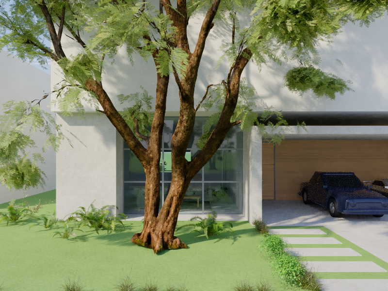

# Facade texture detail

This image shows a close view of the jacaranda trunk and the exposed concrete of
the breeze-block house. It was rendered at 800 × 600 pixels with 96 passes using
the showcase scene and shipped family resources. The scene is reconstructed by
the benchmark rather than opened from the saved sample project.



The jacaranda trunk uses 2048 × 2048 color and normal maps. The saved house
also contains these normal maps. The cast concrete uses a procedural finish;
the white painted surfaces use a separate material. The image is an evaluation
of this scene and lighting, not a measurement of photographic equivalence.

To reproduce the image from the repository root in PowerShell:

```powershell
$env:G3_SHOT_ONLY = 'cobogo-facade-detail'
dotnet run -c Release --project tests/Guanacaste3D.RenderBench -- --shot --out artifacts/facade-detail --width 800 --height 600 --passes 96
```
